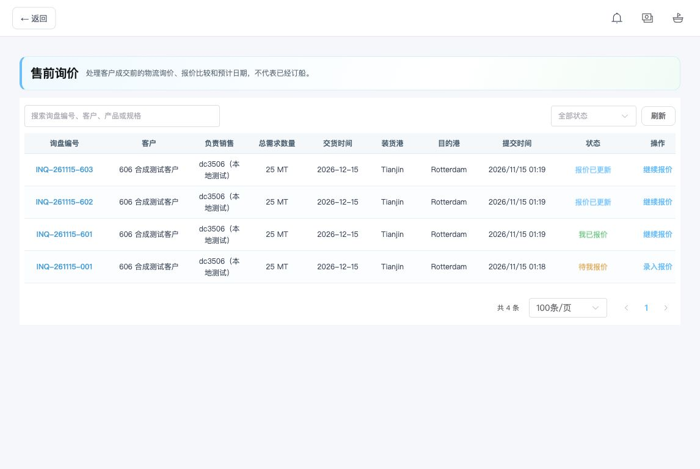
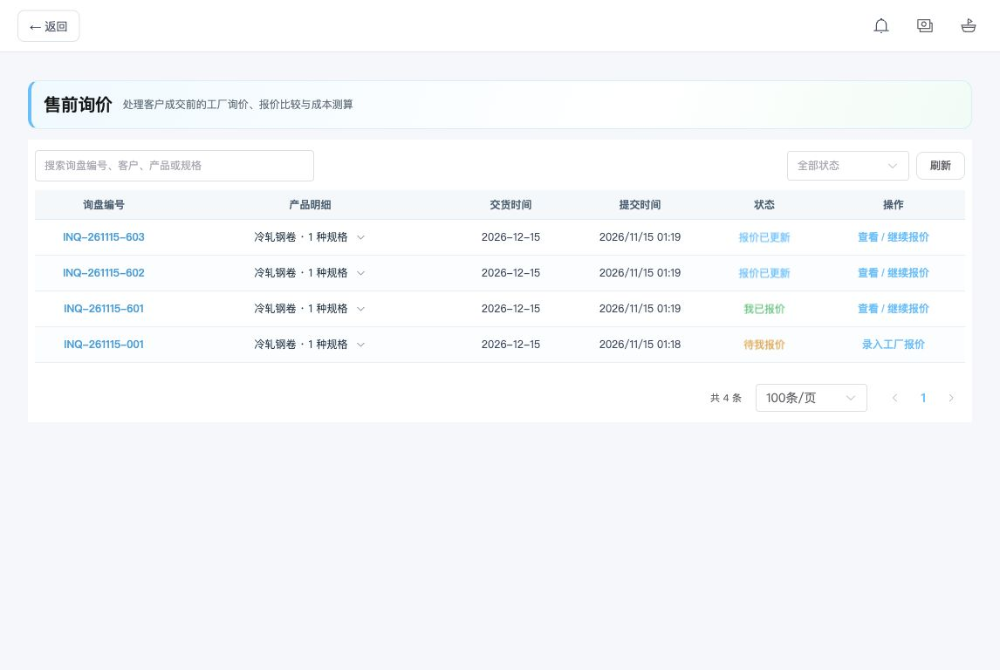
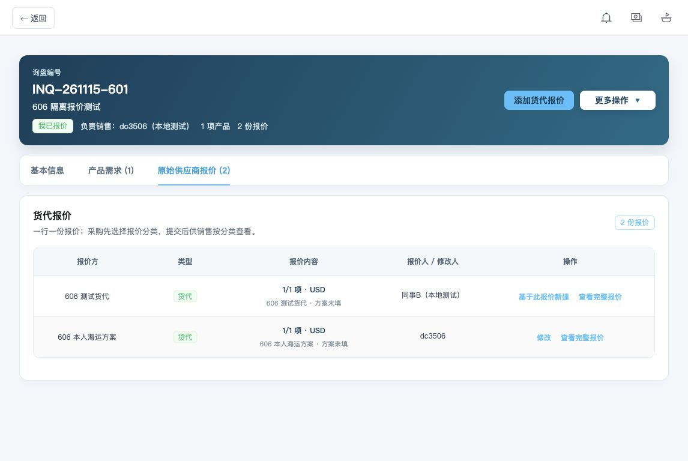
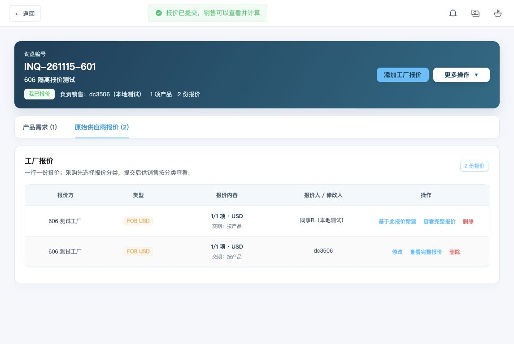

# Issue #606：个人报价状态与独立报价

基于 main `6dbb16fd`，修复分支 `fix/inquiry-personal-quote-status`。

## 状态口径

采购、海运分别按当前登录员工及询盘当前轮次计算：

- 本人没有有效的已提交报价：**待我报价**。本人草稿、其他人的报价不能替代本人提交。
- 本人已提交，且没有更新的同部门他人报价活动：**我已报价**。
- 本人最近保存/提交后，其他人提交或更新了同部门已提交报价：**报价已更新**。
- 打开页面不清除更新提示；本人再次保存/提交有效报价后重新计算。
- 旧轮次、软删除记录、其他租户或其他部门的报价不参与计算。
- 列表、详情与筛选使用同一后端口径；旧客户端的 `QUOTED` 部门级筛选保留兼容。

## 记录保护

前端和后端均只允许作者修改自己的报价。其他人可以查看，或“基于此报价新建”自己的独立记录，不能直接覆盖原报价。原有采购报价删除权限未扩大或另行调整。历史上已发生的共享修改不会被反推恢复；状态计算兼容这类记录的最后修改人。

## 自动化验证

- 前端：类型检查、生产构建通过；全量单测 785 项通过、1 项既有跳过。
- PostgreSQL：专用库 `erp_issue606_20261115`，迁移至 84；采购 `internal/app` 全量回归通过。
- `TestInquiryPersonalQuoteStatus` 对采购和海运各跑两名员工，覆盖个人状态、草稿、筛选、跨部门、旧轮次、软删除、跨租户、历史共享修改、过期版本、撤回重提，以及禁止覆盖他人报价。
- D1 旧专用环境套件仍受其原有独立 DSN 门槛限制，不将默认跳过项冒充已执行。
- 未新增数据库迁移或 proto 修改。

复跑：给 `PROCUREMENT_TEST_DSN` 指定已迁移的专用测试库，在 `services/procurement` 执行 `go test ./internal/app -count=1`。不要指向生产或业务库。

## 浏览器验证（2026-11-15）

真实 Vue 页面、当前源码网关、当前采购业务服务及真实 PostgreSQL，登录使用本地真实 IAM。前端端口 5174、网关 18081、采购 gRPC 19007；原有服务、业务数据库和生产均未更改。

合成询盘及同事 B 的操作由临时测试夹具调用真实业务保存逻辑写入专用库；夹具只负责准备/更新数据，未模拟浏览器 HTTP 响应，也未通过第二个浏览器登录同事账号。双员工权限与状态逻辑另由数据库集成测试覆盖。临时夹具已移除，不作为运行时入口或交付代码。

验收过程：

1. 海运列表出现“待我报价 / 我已报价 / 报价已更新”；个人状态筛选只返回匹配记录。
2. 同事 B 更新自己的报价后，浏览器不手动刷新，`INQ-261115-602` 从“我已报价”自动变为“报价已更新”。
3. 当前登录员工打开 `INQ-261115-601`，对同事的报价只能查看或基于其新建，不能直接修改。
4. 点击新建副本、保存提交，海运及采购均从“待我报价”变为“我已报价”，原同事报价保留。
5. 刷新后两份报价仍在。数据库核对：原作者 #1 的采购/海运记录均仍为 version 1，新作者 #2 的记录各为独立 ID、version 1。
6. 浏览器未捕获运行错误。按仓库要求在 1366×768（含侧栏）核对布局；截图裁去含账号邮箱的左侧栏，保留完整测试内容。

### 海运个人状态

### 采购个人状态

### 海运：本人新报价和同事原报价独立保存

### 采购：本人新报价和同事原报价独立保存

以上为本地隔离环境证据；PR 合并、生产部署及签名验证结果以关联 Issue / PR 的最新交付记录为准。
