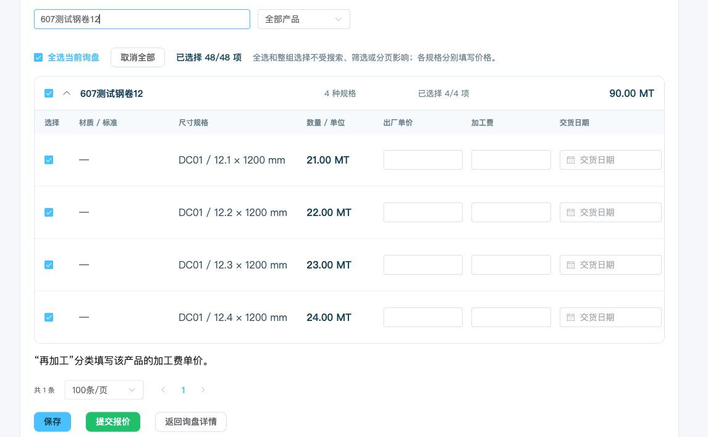
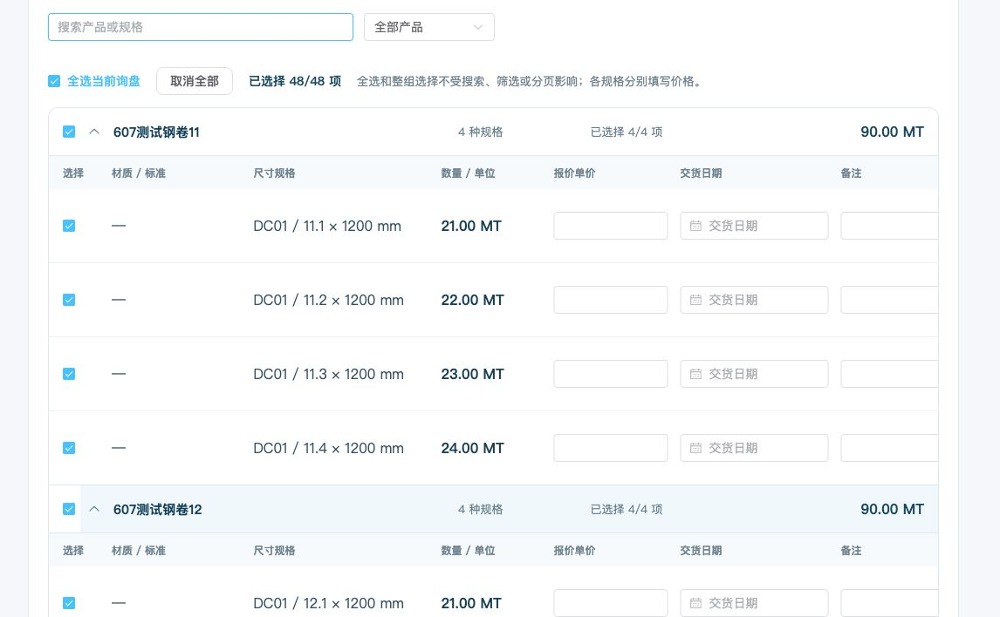
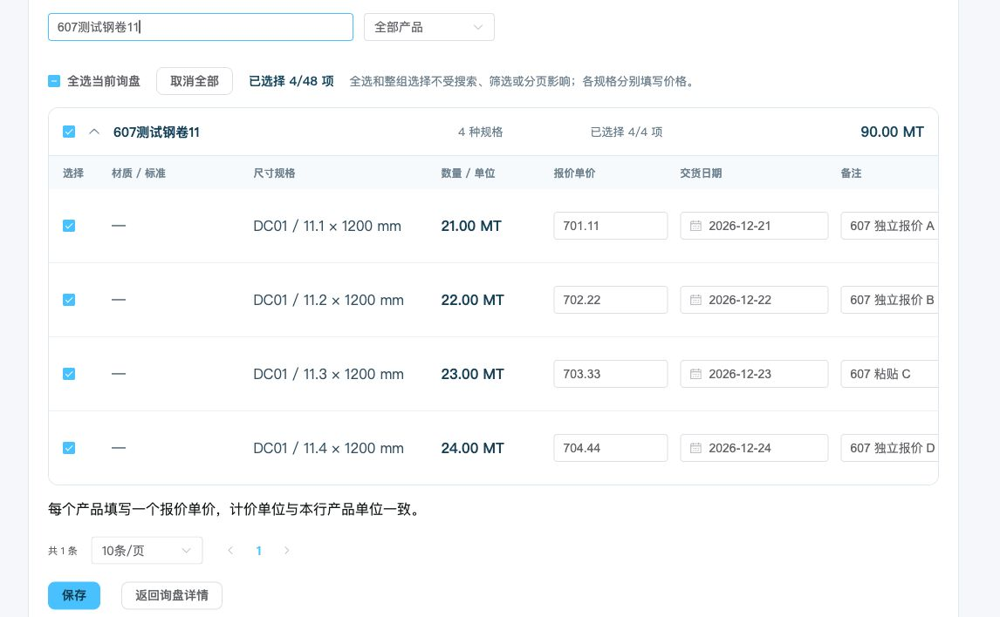
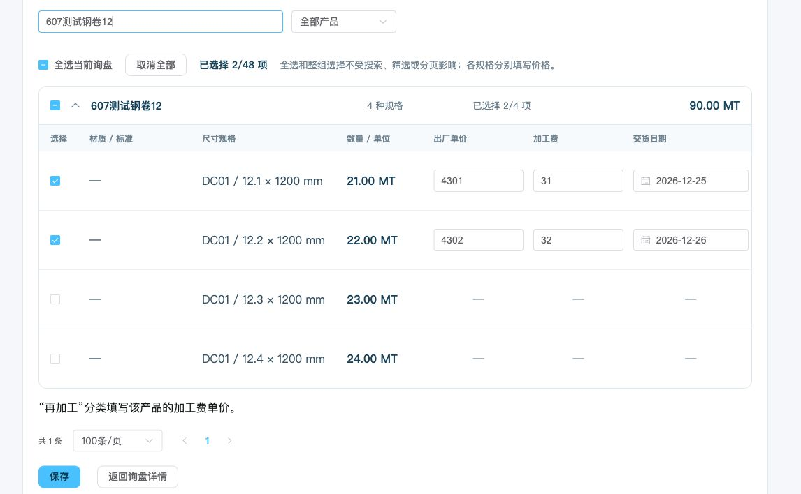

# Issue #607：采购报价批量选择

基线：main `2605ce00`；分支：`feat/procurement-bulk-quote-selection`。以下为本地验收证据；PR、合并、生产部署及签名验证结果以关联 Issue / PR 最新交付记录为准。

## 行为

- 顶部全选覆盖当前询盘全部原始产品行 ID，不受搜索、筛选、分页和折叠影响。显示「已选择 X/Y 项」，支持半选状态。
- 产品组复选框操作该组全部规格，包括搜索或筛选隐藏的规格；与展开按钮独立，批量选中自动展开。
- 全选只补齐缺少的行，不统一填价、不覆盖已有价格、不重复创建报价行。
- 单项、整组或全部取消后，已填字段仅在本次编辑会话中暂存，重新选择恢复。未选行不进入保存/提交请求。
- 顶部取消全部按钮和全选开关的取消操作均先确认。关闭、成功保存、切换报价或重新加载结束会话；失败请求不清除编辑内容。
- 保持原有产品搜索、筛选、分页和 Excel 粘贴。筛选条件保持不变，例如在「未报价产品」下全选后，当前结果为空是筛选的正常结果；总选择数仍显示 48/48。
- 不改变海运逻辑、报价分类、提交校验、API 请求结构或数据库 schema。

## 自动化结果（2026-11-15）

- 前端全量：113 个测试文件通过，812 项通过、1 项既有跳过。
- 新增选择逻辑测试 8 项：跨组跨页、重复全选、按 ID 计数、组选择、单项取消恢复、未选数据不进入请求、会话隔离，以及 Excel 粘贴/再加工字段保留。
- `vue-tsc --noEmit`、Vite 生产构建、`git diff --check` 通过。
- 无后端交付代码改动；不将准备数据的临时夹具算作新增回归测试。

在 frontend 目录复跑：`npm test`、`npm run typecheck`、`npm run build`。

## 实机验收

使用真实浏览器、真实 IAM 登录、真实业务 API 与 PostgreSQL；未 mock HTTP 响应。专用库为 `erp_issue606_20261115`，与业务库隔离。

临时 Go 夹具通过业务服务创建合成询盘 `INQ-261115-607`（ID 287）：12 个产品组，每组 4 个规格，共 48 个规格。准备夹具允许创建测试数据，浏览器所有保存、提交和读取仍走真实 IAM 权限校验。夹具已删除，不作为交付入口。

首次验收使用前一轮的本地隔离后端；最终换成本工作区最新 main 源码的网关和采购服务，并重新验证跨页全选、读取及保存。

- 最终前端：`http://localhost:5175`，网关：18082，采购 gRPC：19008。后端使用独立 `erp.test607.*` 消息主题/消费组；原有服务未替换。
- 按仓库要求以 1366×768（含左侧栏）实测；规格表保留横向滚动，不隐藏价格、交期或备注列。截图仅裁去含登录邮箱的侧栏。
- 每页 10 个产品组时，全选显示 48/48，第二页第 11、12 组的 8 行全部已选且自动展开。
- 搜索单个规格后全选仍选 48 项；整组选择覆盖搜索隐藏的其余规格。未报价筛选下全选同样覆盖全询盘。
- 分别填入 701.11、702.22，交期分别为 12 月 21、22 日，备注不同；单独取消、全部取消后重新选择，输入完整恢复；确认框点取消不改变选择。
- 用真实剪贴板粘贴两行 TSV，第三、四项分别得到 703.33 / 704.44、不同交期及备注。
- 第四行取消后保存草稿，实际只保存 3 项；重开选择第四行时为空，证明未保存内容不跨编辑会话恢复。
- 补填第四行后提交，刷新再打开，四条独立价格、交期、备注均保留，个人状态为「我已报价」。
- 新建再加工报价时无上一份报价的缓存；独立录入出厂单价 4301 / 4302、加工费 31 / 32、不同交期和备注，取消再选全部字段恢复。
- 故意缺少供应商、再加工出厂单价时，后端仍拒绝保存/提交，编辑内容保留；补齐后成功。浏览器记录到对应预期校验错误，不将这些负向测试误报为无错误日志。
- 最新后端再次保存再加工报价，并刷新核对持久化结果。

### 数据库只读核对

| 报价 ID | 分类 | 已提交 | 保存规格数 | 独立内容 |
| --- | --- | --- | --- | --- |
| 89 | FOB_USD | 是 | 4 | 701.11 / 702.22 / 703.33 / 704.44，四个交期、四条备注 |
| 90 | REPROCESSING_CNY | 是 | 2 | 加工费 31 / 32，出厂单价 4301 / 4302，两个交期、两条备注 |

## 截图

### 全选不受搜索影响，不会自动填价

### 跨页全选，第二页已展开

### 提交、刷新后，独立报价数据保留

### 再加工分类和半选状态

