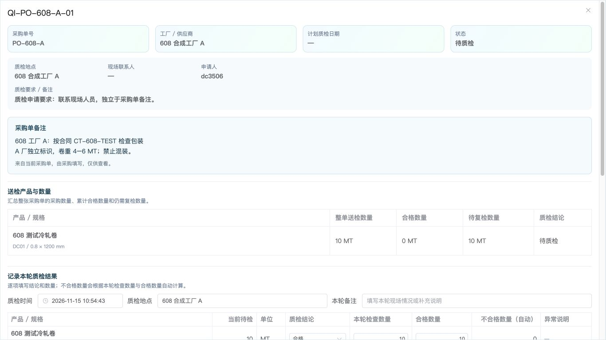
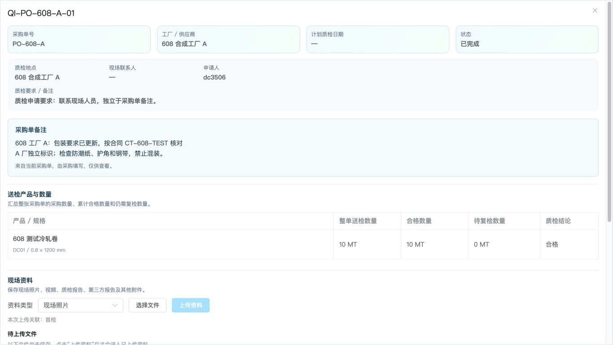
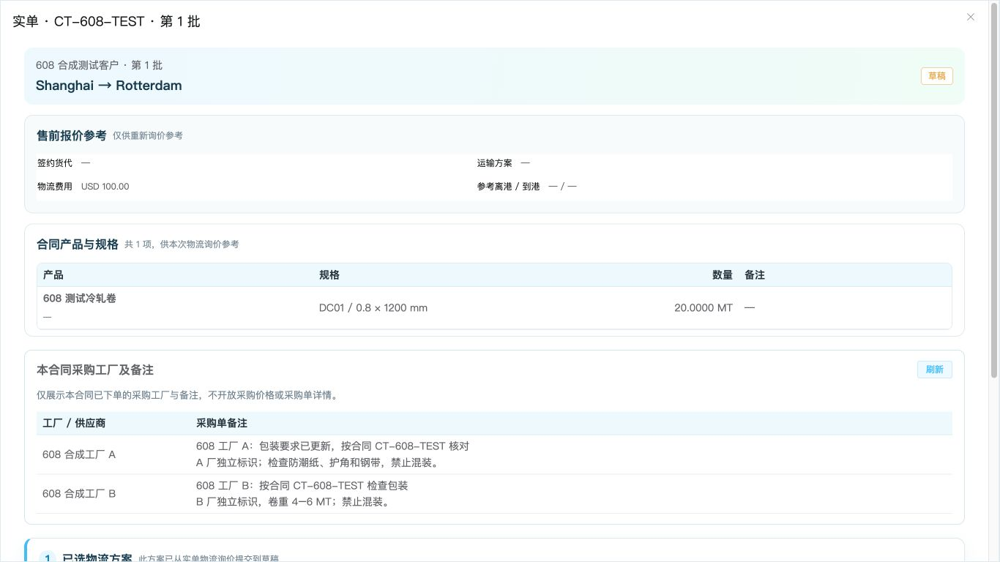
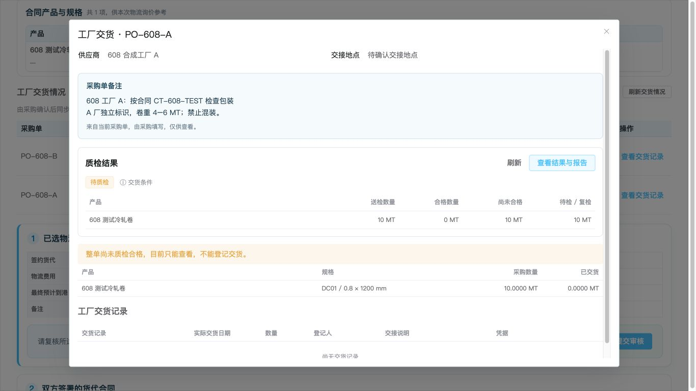

# Issue #608：质检和海运查看采购单备注

基线 main `be42db95`，分支 `fix/procurement-remarks-visibility`。以下为本地实现与验收证据；PR、合并、生产部署及签名核验以关联 Issue / PR 的最新交付记录为准。

## 原因与实现

- 采购录单备注位于 `purchase_orders.remark`；质检原接口只返回 `quality_inspection_tasks.remark`，这是申请质检时另填的要求，并不是采购单备注。
- 质检详情新增只读 `purchaseOrderRemark`，直接从同租户的采购单关联读取，独立保留原 `remark`。原任务无需重新申请或数据回填；采购源备注变更后重新读取即可看到。
- protobuf `QualityInspectionTask` 仅追加字段 27 `purchase_order_remark`，不改旧字段，生成代码已同步。无新增数据库迁移。
- 质检详情将两类备注分别标明为「采购单备注」与「质检要求 / 备注」，采购备注为纯文本、保留换行、长内容自动折行，不可编辑。
- 海运实单新增「本合同采购工厂及备注」只读区域；只读交货记录弹窗也展示备注。不按产品名合并不同工厂的记录。
- 用户确认：没有采购单权限但能查看海运实单的员工，也可查看该合同工厂与采购备注，不开放采购价格。新增 GET `/api/shipping/contract-handoffs/{id}/purchase-remarks` 和内部 `ListShippingPurchaseRemarks` RPC，仅返回 `supplierName`、`purchaseOrderRemark`，无采购单 ID、价格、数量或详情入口。
- 网关从已授权海运实单解析合同，不接受调用者指定合同号；采购侧再次检查海运读权限、同租户、合同 ID/编号、需求行来源、订单类型及已下单状态。原采购单、交货明细接口权限和数据范围不变。无需数据库迁移。

## 自动化检查

- 前端 114 个文件通过：815 项通过，1 项既有跳过；类型检查、生产构建通过。
- 新增组件 SSR 测试：空值及旧接口兼容、中英西文案、只读、HTML 转义和多行文本。
- 采购 `internal/app` 全量数据库回归与 `internal/adapter/grpcin` 通过。增强质检生命周期测试：采购/申请备注独立、原任务读取更新备注、空采购备注不误用申请备注、租户和数据范围拒绝、完成后备注仍保留。
- protobuf 到 HTTP JSON 字段映射测试通过，字段名称为 `purchaseOrderRemark`。
- 网关 `internal/httpapi` 全量回归通过：跨页查询、同产品多工厂独立备注、不同合同过滤、权限拒绝及不输出采购价格。
- 新只读入口额外测试：只有海运权限可读、未登录/无权限拒绝、合同参数注入无效、海运实单访问拒绝后不查询采购。响应严格只有两个字段，不调用完整采购单接口。数据库集成覆盖同规格多工厂、其他租户、合同 ID/编号不符、来源不符、草稿排除、旧订单来源为零、现有订单权限仍拒绝、当前空备注及权限依赖缺失时关闭访问。
- `make proto`、`make proto-breaking`、SQL 参数静态检查、`git diff --check` 通过。
- 起初旧测试库缺少最新 main 的物流字段；未改动业务库或旧库，改用全新专用库迁移后重跑。

## 隔离环境

- 采购：`erp_issue608_procurement_20261115`，迁移到 86；船运：`erp_issue608_shipping_20261115`，迁移到 30。
- 前端 5176，网关 18083，采购 gRPC 19017，船运 gRPC 19019。均为本工作区源码；Kafka 使用 `erp.test608.*` 专用主题/消费组。
- 真实 IAM 登录和业务 API，没有 mock 浏览器 HTTP 响应。未修改实际业务数据、账户权限或生产。
- 额外无采购权限实机环境：独立 IAM 库 `erp_issue608_iam_20261115`，前端 5177、网关 18084、IAM 19011、采购 19027、船运 19029。合成账户 `shipping608@example.test` 仅具有海运读业务权限及系统默认邮箱权限，没有采购单权限，采购数据范围为 SELF。启动必需的 SUPER_ADMIN 角色未分配给任何账户。临时建号夹具已移除。
- 合成订单由临时 Go 夹具写入专用库；质检申请和船运交接通过真实业务逻辑创建。夹具已移除，不作为运行时入口。
- 测试中的采购源备注变更直接写入专用库以模拟已有数据变化；不冒充采购录单页面的编辑测试。

## 浏览器点击验收（2026-11-15，1366×768 含侧栏）

1. 质检列表点击 A 厂任务的「更多操作 → 处理」，任务 `QI-PO-608-A-01`（35）显示采购单 `PO-608-A`（114）的多行备注，并独立显示申请要求。
2. 打开 B 厂任务（36），显示 B 厂的备注，不沿用 A 厂内容。
3. 打开海运合同 `CT-608-TEST`、第 1 批（handoff 1），同一产品下有两张采购单：A 厂和 B 厂。各自备注与工厂对应；第三张 `PO-608-OTHER` 属于其他合同，未出现在本合同列表。
4. 海运点击 A 厂「查看交货记录」，只读弹窗显示 A 厂采购备注，无登记交货按钮，原质检门槛不受影响。
5. 直接更新专用库的 A 厂采购源备注，海运点击「刷新交货情况」后显示新内容；原质检任务 35 重开也显示新内容，申请备注不变，没有重新申请或创建任务。
6. 浏览器保存本轮合格结果，任务 35 变为已完成；采购备注、申请备注仍独立保留。浏览器控制台错误记录为空。
7. 无采购权限账号登录 5177，打开海运实单并点击新区域「刷新」，显示本合同 A/B 工厂的独立多行备注，不显示其他合同工厂，也没有采购详情入口。真实 HTTP 验证：新接口 200 且严格两字段；注入其他合同查询参数仍只返回本合同 A/B；采购单列表、采购详情、旧交货明细接口均 403；不存在的海运实单 404；未登录 401。

测试入口：`http://localhost:5176/quality/tasks?task=35` 和 `http://localhost:5176/shipping/orders?handoff=1`。

## 截图

### 质检可见两类独立备注

### 原任务读取更新备注，完成后仍可查看

### 海运无采购权限仍可查看本合同工厂与备注

`shipping-factory-remarks.jpg` 为初版有采购权限的交货表截图，保留作为历史验证；最终新增只读区域以上图为准。

### 海运只读交货弹窗

