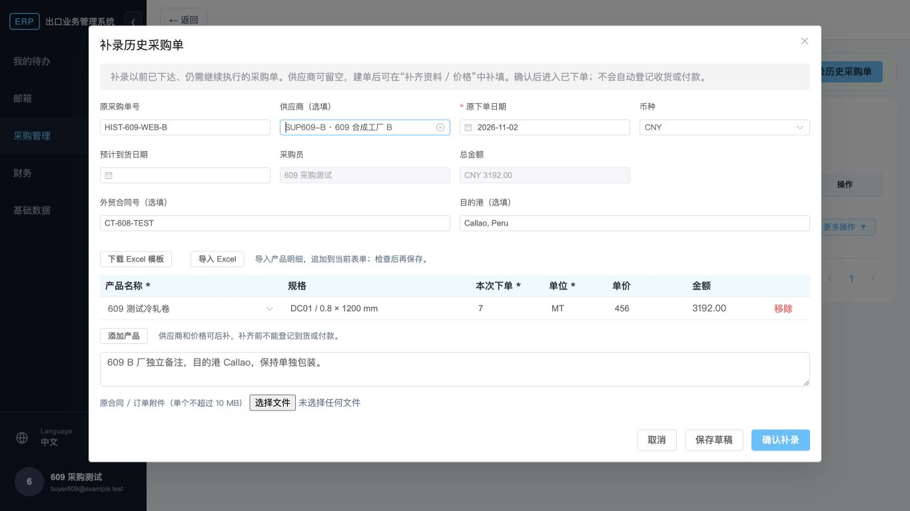
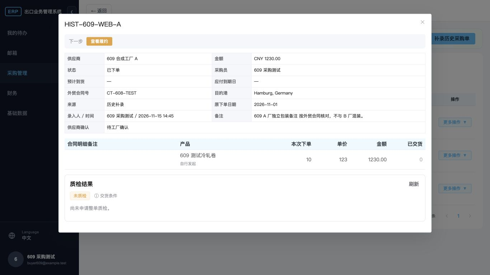
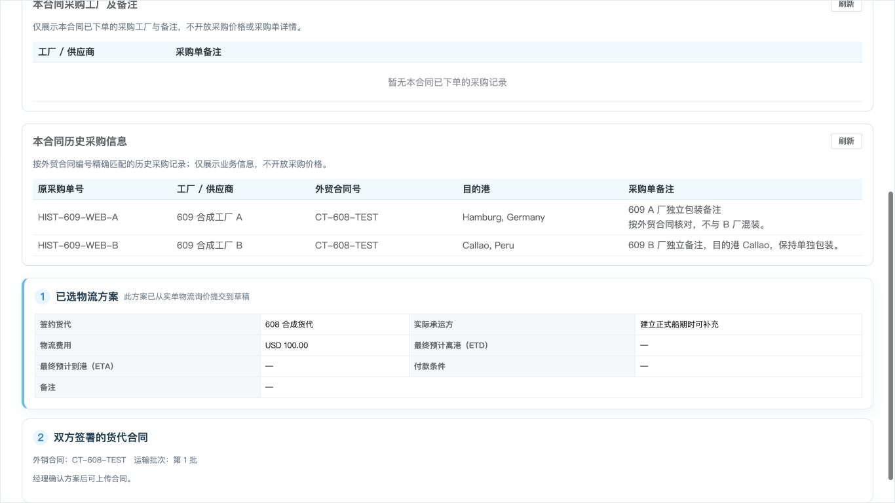

# Issue #609：历史采购单外贸合同号与目的港

基线 main `9913153a`，分支 `fix/historical-purchase-shipping-context`。本文件记录本地实现与验收；PR、合并、生产部署和提交签名结果以关联 Issue / PR 的最新发布记录为准。

## 实现与边界

- 补录、继续补录、补齐历史采购单表单增加「外贸合同号（选填）」「目的港（选填）」，分别最多 50 / 200 字，前后空格标准化；支持空值保存草稿、确认、回显、后续编辑及清空。
- 采购迁移 `00087_historical_shipping_context.sql` 在 `historical_purchase_orders` 增加两个非空、默认空字符串的资料字段。已有采购、付款标识及合同来源 ID 不回填、不改写。
- 保存历史单请求兼容追加 protobuf 字段 14 / 15；采购订单响应复用 `exportContractNo`，追加 `destinationPort` 字段 63。仅历史单应用新资料，普通采购单保留原合同快照。
- 独立 PUT `/api/purchase-orders/{id}/historical-shipping-context` 仅更新这两个历史资料字段。需要采购单读/写权限及原数据范围；普通采购单不接受此写入。已收货、已申请付款的历史单也能补充资料，不通过原价格编辑接口绕过执行/财务锁。
- 原完整历史单编辑的供应商、价格、产品数量、已申请付款等限制保持不变。新增资料更新不触碰采购单/产品行、价格、金额、交货、付款、状态、原财务合同快照和来源 ID，也不创建正式合同、采购需求或海运任务。
- 用户确认海运采用现有合同编号精确匹配。新增 GET `/api/shipping/contract-handoffs/{id}/historical-purchases`：先读取员工可见、已关联正式合同的海运实单，再从该实单解析合同号，忽略 HTTP 查询参数中的合同号/ID。
- 采购侧再次校验租户、海运查看权限，只返回编号完全相同且已下单/部分交货/已交货的历史采购记录；草稿、取消单、其他合同及其他租户排除。未匹配的单仍正常保存，不自动建立业务关联。
- 海运只读响应严格为 `poNo`、`supplierName`、`exportContractNo`、`destinationPort`、`remark` 五项，无价格、金额、数量、完整采购单 ID 或写入口。原 #608 两字段备注接口与采购单权限未修改。
- 新文案覆盖中英西；历史单详情改为双列、较宽只读布局，补录表单两项各占半行，并限制弹窗内容高度，1366×768 含侧栏检查，无须遮盖已有资料。

## 自动检查

- 前端全量 115 个测试文件通过，819 项通过，1 项既有跳过；类型检查、生产构建通过。
- 新增 4 项前端测试：旧响应/空值兼容、纯文本及独立值、元数据请求不带财务字段、中英西词条、表单字段可选且参与已有保存/回显逻辑。
- 采购应用层、gRPC 及网关 httpapi 全量相关回归通过；采购测试连接专用真实 PostgreSQL，没有因缺 DSN 跳过本次数据库用例。
- `make test` 跨模块 Go 回归通过，采购与网关 `go vet` 通过。该轮仅配置采购集成测试 DSN，其他服务依赖未配置专用 DSN 的数据库测试仍按既有规则跳过，不冒充全服务数据库验收。
- 新增数据库测试：空值建单/确认、确认后填入、长度/Unicode/空格、只读接口精确匹配、相似合同号/跨租户/草稿/取消排除、缺少权限或 IAM 依赖时拒绝、清空后移除旧匹配。
- 用数据库夹具模拟部分交货和已申请付款，对比整个采购单和产品行 JSON，确认元数据编辑前后逐字段相等；该项不是实际收货或付款操作。
- gRPC 测试同时验证列表与详情的 `exportContractNo` / `destinationPort` JSON 字段、普通采购单合同快照不变、普通单禁止历史资料写入。
- 网关测试验证先校验海运实单、无登录/无权限拒绝、忽略合同注入、五字段白名单、路径 ID 优先于请求体 ID、元数据更新需要采购写权限、拒绝注入价格字段。
- 专用迁移库通过完整 Up → Down → Up，包含新列存在性检查。协议兼容、租户、迁移安全、SQL 参数、重复路由、权限审计及 `git diff --check` 通过。

## 真实浏览器与 HTTP 验收（2026-11-15）

使用真实 IAM 登录、业务 API 及数据库，不拦截或伪造浏览器网络响应。采购与海运分别使用两个合成账号；海运账号没有采购单读写权限。

1. 浏览器创建 A 厂 `HIST-609-WEB-A`：两项外贸信息均留空，保存草稿，重新打开仍为空；选择 A 厂后确认补录成功。10 MT，独立单价 123、金额 1230，A 厂备注保留。
2. 在「更多操作 → 补充外贸信息」填写 `CT-608-TEST` 和 `Rotterdam, Netherlands`；采购详情显示正确。
3. 创建 B 厂 `HIST-609-WEB-B`：初次即填写同一合同号和 `Callao, Peru`，产品同规格但数量 7 MT、单价 456、金额 3192，备注独立。保存草稿、重新打开后，两项新资料及产品价格均正确回显，再确认补录。
4. 海运打开既有合成合同 `CT-608-TEST` / 第 1 批，刷新「本合同历史采购信息」后可见 A/B 两条独立工厂、合同号、目的港和备注，无采购价格。
5. 真 HTTP 把 A 厂目的港改为 `Hamburg, Germany`，采购 GET 前后仅删除这两项展示资料后整个响应严格相等；海运点击刷新显示新目的港。最终截图以 Hamburg 为准。
6. 真 HTTP 将 A 厂合同号/目的港清空，海运只返回 B；恢复后再次返回 A/B。
7. 通过实际补录业务 API 创建 `HIST-609-UNMATCHED`，合同 `CT-608-TEST-OTHER`。建单成功，但不出现在上述海运合同中。请求附带其他合同查询参数仍只返回 A/B，没有新建海运实单。
8. 真 HTTP 负向：海运读取采购列表、采购详情、旧交货明细及写入元数据均 403；超长目的港、混入价格字段均 400；未知海运实单 404；未登录 401。拒绝后资料不变。
9. 采购与海运浏览器控制台 error 列表均为空。三张截图均为 1366×768 CSS 视口。

## 隔离环境

- 采购库 `erp_issue609_procurement_20261115`（87），基础数据库 `erp_issue609_masterdata_20261115`（32），迁移库 `erp_issue609_migrations_20261115`。
- 前端 5178，网关 18085，采购 19037，基础数据 19032；Kafka 使用 `erp.test609.*` 独立主题和消费组。
- 仅在既有隔离 IAM 库新增合成采购账号（临时建号测试夹具已移除）；只读复用 #608 的合成海运实单及海运账号。未变更真实员工权限、真实业务库或生产。
- 两条合成工厂及负责人关系只写入 #609 专用基础库。A/B 单由浏览器创建，未匹配单由真实 HTTP 业务 API 创建；收货、付款、签署、审批均未推进。

## 截图

## 发布顺序

先执行采购迁移 87，再更新采购服务、网关和前端。接口兼容追加；不执行历史合同号自动回填，不自动创建海运任务。发布结果以关联 Issue / PR 的最新记录为准。
