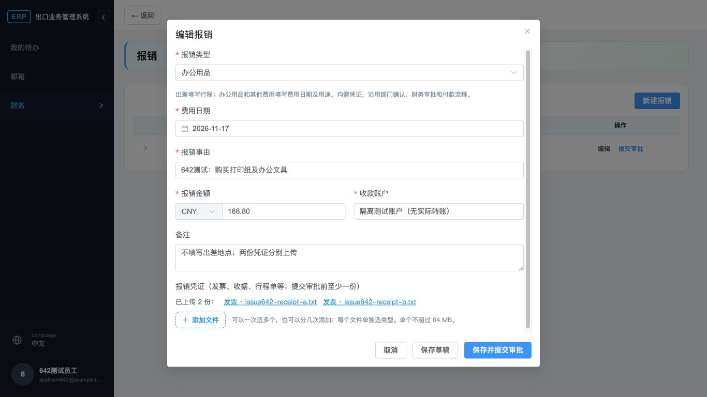
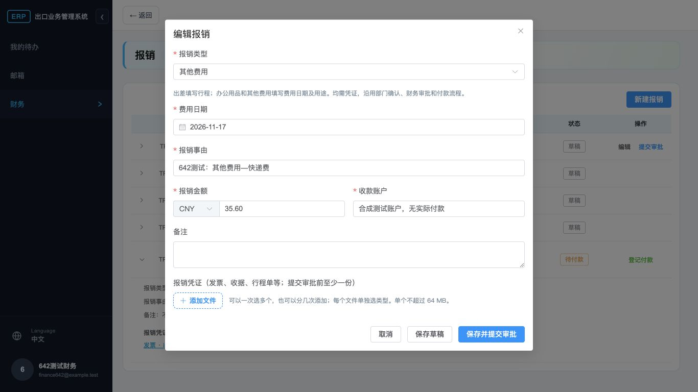
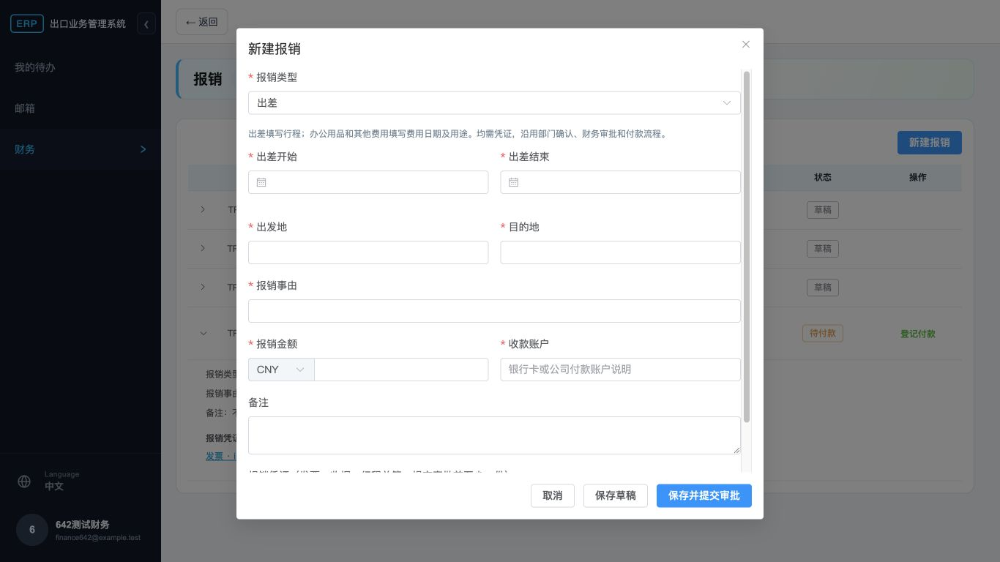
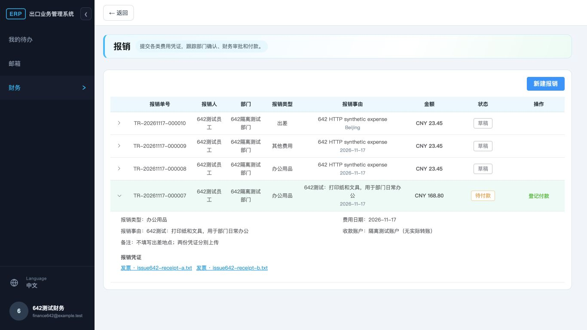

# Issue #642：支持出差以外的费用报销

基线 main `6730ff00`，分支 `feat/reimbursement-expense-types`。本记录为本地实现与验收；PR、合并、签名及生产部署结果以关联 Issue / PR 的最新发布记录为准。

## 实现

- 入口、列表及待办业务名称由「出差报销」统一为「报销」。新增出差、办公用品、其他费用三种类型。
- 出差沿用起止日期、出发地、目的地；办公用品和其他费用填写费用日期及用途，不要求虚填出差行程。金额、币种、收款账户、备注及多附件保留。
- 类型参与保存、编辑、列表和详情回显，审批摘要显示类型及费用日期；新增文案和业务名称覆盖中英西。
- 切换类型时，隐藏字段保留在尚未保存的表单中，但不提交或持久化不适用字段；后台再次校验类型、日期及原有金额/账户/事由规则。旧请求未传类型仍按出差处理。
- 历史记录默认 `TRAVEL`，不重写原日期、金额、审批、付款或单号。继续使用原审批业务类型 `TRAVEL_REIMBURSEMENT`、既有部门负责人/财务负责人流程及原权限。
- 修改待付款报销仍使原审批失效，需重新提交；审批中和已付款单据保持编辑锁。凭证上传和至少一份凭证的提交门槛不变。
- 1366×768 含侧栏检查：内容区可滚动、底部操作可见；列表缩紧列宽，金额、状态和操作不再被新类型列挤出屏幕。
- 本次不包含 #641 的删除功能，不执行任何真实转账。

## 接口与迁移

- 采购迁移 `00089_reimbursement_expense_types.sql` 添加 `expense_type`（默认 `TRAVEL`、限定三种值）、可空的 `expense_date`，允许非出差记录的两个原行程日期为 NULL。
- protobuf 兼容追加：响应字段 26/27，创建请求 10/11，更新请求 11/12；路径、权限和 RPC 名称保持不变。sqlc/protobuf 已重新生成。
- 发布需先迁移采购库，再更新采购、网关及前端。Down 保留新资料，不为非出差单据编造行程日期；支持迁移 Down → Up 重试。
- **回滚边界**：旧采购二进制不能读取包含 NULL 行程日期的非出差单据，因此产生此类记录后不能仅降级到旧采购程序。需要保留新读取逻辑；Down 仅保留数据，不承诺旧二进制可直接回退。

## 自动验证

- 前端全量 122 个文件，847 项通过、1 项既有跳过；类型检查和生产构建通过。
- 新增前端 4 项测试：旧记录默认类型、条件必填、隐藏字段请求投影且不改变表单/凭证、三语言词条。
- 真实采购 PostgreSQL：办公用品及其他费用完整生命周期、凭证门槛、列表回显、非本人/跨租户拒绝、退回重提、类型切换使原审批失效、旧审批拒绝、付款编辑锁及冲销保留类型；原出差生命周期回归通过。
- gRPC JSON/应用输入/响应字段映射及类型、日期、金额等校验回归通过；采购应用、gRPC、网关及审批相关包回归通过。
- 专用迁移库先建 v88 的已付款出差夹具，再应用 v89，核对原日期、地点、金额、状态不变且默认出差；新增办公用品后单项 Down → Up 不丢资料，再完成全量 Down → Up。
- 跨模块 `make test`、采购/网关 `go vet`、协议兼容、租户、迁移安全、SQL 参数、重复路由、权限审计及差异格式检查通过。该轮仅配置采购集成 DSN；其他模块依赖未配置专用 DSN 的数据库用例保持既有跳过，不等同于全服务数据库实测。

## 真实浏览器 / HTTP 验证（2026-11-17）

使用真实 IAM、网关、采购、审批、Kafka 和 MinIO，没有伪造浏览器网络响应。三名合成员工在独立 IAM 库配置最小验收权限。

1. 普通员工创建 `TR-20261117-000007`，类型办公用品，费用日期 2026-11-17、CNY 168.80；不填任何行程资料，选择两份合成 txt 凭证，经真实上传/登记后保存成功。
2. 重新打开，类型、费用日期、金额、账户、备注和两份凭证均回显；提交进入部门负责人确认。
3. 部门负责人从待办进入同一单据，检查费用类型、日期、用途和凭证，填写原因退回。
4. 申请人补充用途后重提，仍是同一单号、同一金额、两份原凭证；部门负责人确认后，财务待办显示对应类型及日期。
5. 财务审批后进入待付款，保留全部资料和「登记付款」入口，浏览器不继续登记付款。
6. 浏览器另建 `TR-20261117-000011`，其他费用/快递费，CNY 35.60，保存草稿并重新打开正确。出差表单仍显示原四项行程必填字段。
7. 真实 HTTP 分别创建三种类型（含不传类型的旧请求），列表读回一致；无费用日期、非法日期/类型、缺行程、负金额、缺账户均 400；普通员工调用付款登记返回 403。
8. 最终财务验收页控制台 error 为空。浏览器截图均为 1366×768 CSS 像素，包含 ERP 侧栏。

## 测试环境与已排除的问题

- 独立数据库：`erp_issue642_procurement_20261117`、`erp_issue642_iam_20261117`、`erp_issue642_approval_20261117`、`erp_issue642_migrations_20261117`。不修改现有业务库、真实员工或生产。
- 前端 5179、网关 18087、IAM 19041、审批 19045、采购 19047；独立 Kafka 主题/消费组 `erp.test642.*`，使用现有本地 MinIO 保存合成凭证。
- 首次管理员验收触发未接入隔离环境的提醒接口，已改用最小权限的三角色账号；没有通过修改真实服务密钥或关闭安全校验绕过。
- 新 Kafka 主题建立前消费者已启动，最初未分配分区，导致退回未同步。确认主题和分区后，仅重启本次测试消费者，原退回事件正常处理；未手工更新报销业务状态。
- 创建三角色账号的临时测试夹具已移除，密码和内部签名密钥未提交。单元测试的付款/冲销为隔离数据库业务函数验证，不发生银行转账。

## 截图

